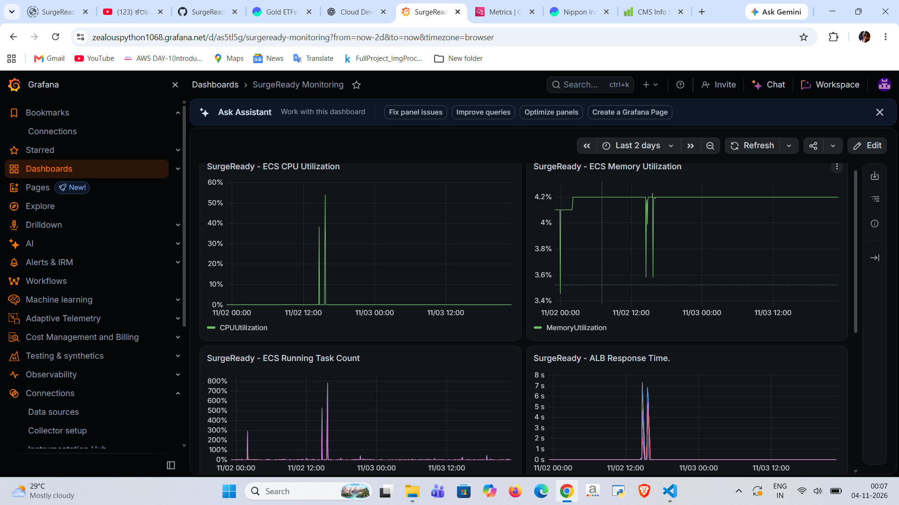
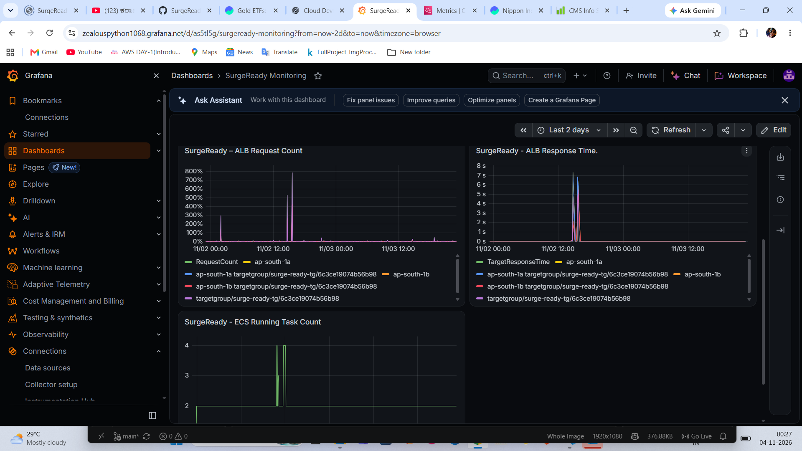
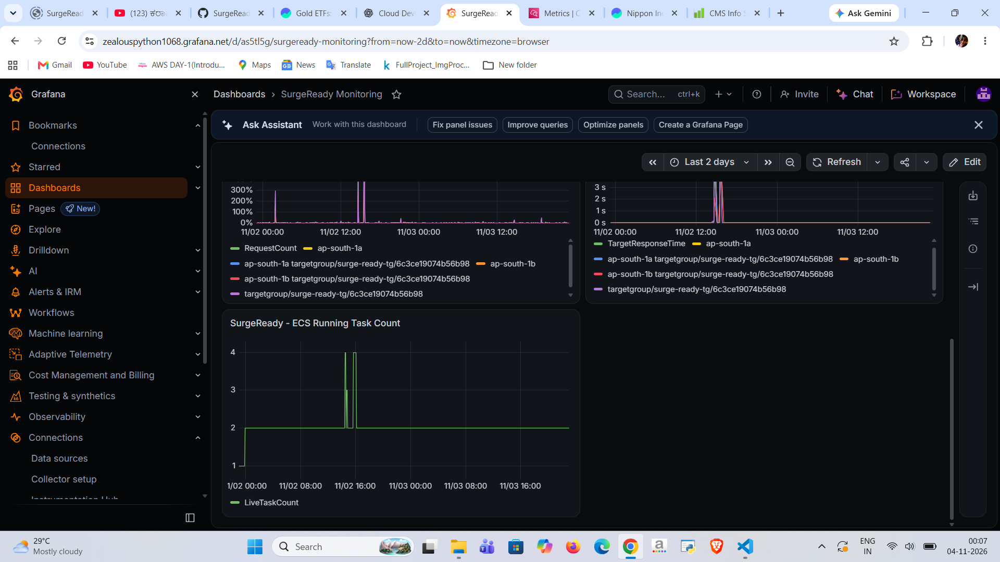
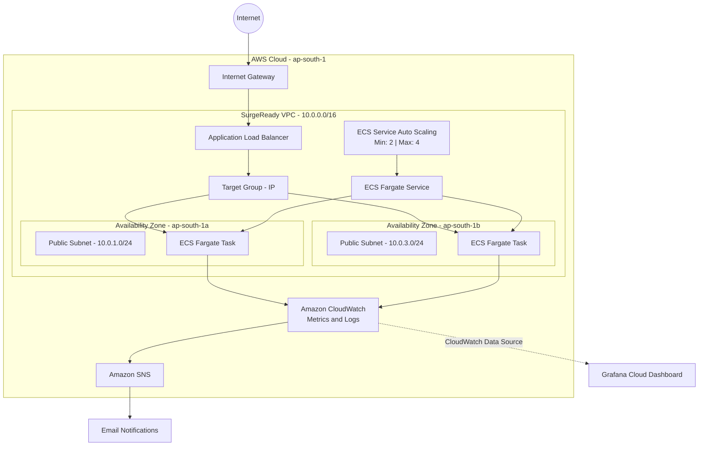

# SurgeReady – AWS Auto-Scaling Application Infrastructure

## Project Overview

SurgeReady is a cloud infrastructure project designed to demonstrate how an application can handle sudden increases in traffic using AWS infrastructure, containerization, load balancing, and automatic scaling.

The application is deployed using Amazon ECS with AWS Fargate, distributed across two Availability Zones, and exposed through an internet-facing Application Load Balancer.

The infrastructure is provisioned using Terraform.

## Architecture

**Architecture flow:**

Internet Users → Internet Gateway → Application Load Balancer → Target Group → ECS Fargate Tasks → Flask Application

Supporting services:

- Amazon ECR – Container image storage
- Amazon CloudWatch – Application logs, metrics, and alarms
- Amazon SNS – Email notifications
- Grafana Cloud – Infrastructure monitoring dashboard

### Network Architecture

- AWS Region: `ap-south-1`
- VPC CIDR: `10.0.0.0/16`
- Two Availability Zones
- Two public subnets hosting the ALB and ECS tasks
- Two private subnets provisioned but not currently used by ECS
- Internet Gateway and public routing

**Cost-conscious design:** ECS tasks currently run in public subnets with public IP addresses. This avoids NAT Gateway charges for this project.

## Technology Stack

| Category | Technologies |
|---|---|
| Cloud | AWS |
| Infrastructure as Code | Terraform |
| Containerization | Docker |
| Container Registry | Amazon ECR |
| Container Orchestration | Amazon ECS |
| Compute | AWS Fargate |
| Load Balancing | Application Load Balancer |
| Application | Python, Flask |
| Monitoring | CloudWatch, Grafana Cloud |
| Notifications | Amazon SNS |
| Load Testing | k6 |

## Application Endpoints

| Endpoint | Purpose |
|---|---|
| `/` | Application homepage |
| `/health` | Application health check |
| `/work` | CPU-intensive workload for load testing |

## ECS Configuration

- Launch type: AWS Fargate
- Task CPU: 256 units (0.25 vCPU)
- Task memory: 512 MiB
- Container port: 80
- Desired task count: 2
- Minimum tasks: 2
- Maximum tasks: 4

## Auto Scaling

ECS Service Auto Scaling uses target tracking based on average CPU utilization.

| Setting | Configuration |
|---|---|
| Scaling policy | Target tracking |
| Metric | ECS Service Average CPU Utilization |
| Target CPU | 60% |
| Minimum tasks | 2 |
| Maximum tasks | 4 |
| Scale-out cooldown | 60 seconds |
| Scale-in cooldown | 60 seconds |

During load testing, ECS scaled from 2 to 4 tasks and subsequently returned to 2 as demand decreased.

## Load Testing Results

A 5-minute k6 load test was performed against the `/work` endpoint.

| Metric | Result |
|---|---:|
| Virtual users | 25 |
| Duration | 5 minutes |
| Total requests | 1,217 |
| Throughput | 3.936 requests/sec |
| Checks passed | 100% |
| HTTP failures | 0% |
| Average response time | 5.26 seconds |
| Median response time | 5.51 seconds |
| 90th percentile | 9.79 seconds |
| 95th percentile | 10.43 seconds |
| Maximum response time | 12.88 seconds |

The test demonstrated that the ECS service could scale its task count in response to increased CPU utilization while maintaining successful HTTP responses.

## Monitoring and Alerting

### Amazon CloudWatch

- ECS CPU utilization monitoring
- ECS memory utilization monitoring
- ECS application logs
- ECS CPU and memory alarms configured above 70%
- SNS email notifications for alarm notifications

CloudWatch alarms provide monitoring and notifications, while ECS target tracking independently manages service scaling.

### Grafana Cloud Dashboard

The Grafana dashboard uses Amazon CloudWatch as its data source and contains five monitoring panels:

1. ECS CPU Utilization
2. ECS Memory Utilization
3. ECS Running Task Count
4. Application Load Balancer Request Count
5. Application Load Balancer Target Response Time

#### Grafana Dashboard Screenshots

**ECS CPU and Memory Utilization**

**Application Load Balancer Metrics**

**ECS Running Task Count and Auto Scaling**

## Infrastructure as Code

Terraform provisions the AWS infrastructure, including:

- VPC and subnets
- Internet Gateway and route tables
- Security groups
- Application Load Balancer and target group
- ECS cluster, task definition, and service
- IAM execution role
- CloudWatch log group and alarms
- ECS Service Auto Scaling

## AWS Architecture

## Repository

GitHub: https://github.com/AshishVittal/SurgeReady

## Future Improvements

- Implement GitHub Actions CI/CD with AWS IAM OIDC federation.
- Add controlled failure and recovery testing.
- Improve infrastructure security by moving ECS tasks into private subnets with an appropriate private image-pull and logging connectivity design.
- Add architecture and monitoring screenshots.
- Improve cost optimization and deployment lifecycle management.

## Learning Outcomes

This project provided practical experience with AWS networking, Terraform, Docker, ECS Fargate, load balancing, service auto scaling, monitoring, alerting, and infrastructure troubleshooting.
